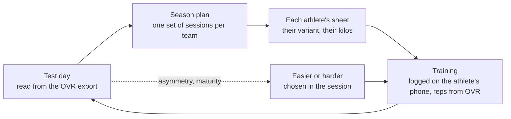

# Athletes, coaches and the training model

*Design, 7 October 2026. Describes the model the code implements, and what is
still to build for athletes. The decisions behind it are listed at the end and
in `IMPLEMENTATION_PLAN.md`.*

Testing is Spenst's front door; programming is where testing pays off. The
model, in one sentence: **each team trains one season plan of shared
sessions; athletes differ in the variant they do and the kilos they lift, and
the kilos come from measurements and the variant is picked in the session — no separate programs.**

## The loop



- **Individual by choice, not by program.** Everyone trains the team's
  sessions. A session says "split squat, easier variant available"; each
  athlete picks the level for the day in the session, with the coach.
- **Velocity is a target where it is prescribed** ("back squat 4 × 3 at
  0.75–0.90 m/s"), with an optional bar-speed rule for adjusting the load set
  to set. Every rep OVR records is kept and shown on the athlete page.

## Variants: an in-session choice

- A slot can offer an **easier** and a **harder** variant: another exercise,
  with the slot's prescription or its own. The library suggests natural ladders
  (goblet squat → back squat, band-assisted → strict pull-up, box jump → drop
  jump).
- **Which one is decided in the session**, by the athlete with the coach on the
  day — how they feel, what hurts, what went well last time. It is not an
  athlete setting; the log records the exercise actually done, and that history
  is what tells the coach where someone is.

## Roles

| Role | Can | Cannot |
|---|---|---|
| **Coach** (on one or more teams) | Plan the season, build and publish sessions, run test days, see all logs and tests for their teams | See teams they are not on |
| **Athlete** (14+) | See the published sessions of their teams with their own variants and kilos; log sets, readiness and session RPE; see their own tests, profiles and history; see leaderboards | Edit sessions; see other athletes' data beyond leaderboards |

An S&C coach on several teams plans each team's season separately; copying a
session or a block between teams is the planned shortcut (not built).

## How athletes get in

- The coach invites from the roster (link or QR code). The athlete sets a
  password and the account is linked to the existing athlete record
  (`athletes.profile_id`), so earlier tests and profiles are theirs from day one.
- **14 and up**, counted from the year they turn 14 (Norwegian age classes).
  That is above Norway's age of digital consent (13): athletes consent to
  stored measurements themselves, and there are no guardian accounts.
- An athlete on two teams has one account and sees sessions from both.

## The athlete's phone (to build next)

```
┌ Today ──────────────────────────────┐   ┌ Session · Strength A ───── 3/6 ┐
│ Tuesday 13 October                  │   │ A  Back squat                  │
│                                     │   │ 6 × 3 · 72.5 kg                │
│ ┌ Strength A · Men's senior ──────┐ │   │ Speed squat: up as fast as     │
│ │ 3 exercises · about 40 min      │ │   │ you can                        │
│ │ Main lifts                      │ │   │                                │
│ │                                 │ │   │ Set   kg     reps   ✓          │
│ │ How do you feel? ○○○○●          │ │   │  1    72.5   3      ✓          │
│ │        [ Start session  → ]     │ │   │  2    72.5   3      ✓          │
│ └─────────────────────────────────┘ │   │  3   [72.5]  [3]   [ Log ]     │
│                                     │   │                                │
│ Thursday: Speed and power           │   │ ⏱ Rest 2:30   ▶ Video · Cue    │
└─────────────────────────────────────┘   └────────────────────────────────┘
```

- **Their own sheet:** each slot shows their kilos, and where a slot has
  variants, easier / standard / harder to pick from on the spot; the log records
  what was done.
- **Prefilled, one tap per set**, offline first (halls have poor signal),
  readiness before and session RPE after.
- **At the OVR rack:** a set marked for live feedback asks for the best rep's
  velocity (typed — one number per set) and shows green/red and the next load.
- "Skipped" and "pain" with a reason, which the coach sees.

The rack tablet and coach logging reuse the same player later.

## The prescription vocabulary (built)

An exercise declares what it can be measured in; a set group sets targets in
that vocabulary; a log records actuals in the same terms (`lib/training.ts`).

| Metric | Unit | Notes |
|---|---|---|
| `reps` | count | |
| `load` | kg | |
| `velocity` | m/s | the target for a profile load, or live feedback |
| `power` | W | logged, not prescribed |
| `contacts` | ground contacts | plyometrics; counted per session |
| `height` | cm | |
| `distance` | m | |
| `time` | s | |
| `rpe` | 1–10 | assistance work and youth loads |

Sets, side (per-side work) and rest are structure, not metrics. A session is
sections (Warm-up · Speed focus · Main lifts · Accessories · Conditioning) →
slots (A1/A2 when paired) → set groups (a ramp is several groups) → variants.

## Defaults for 14–17-year-olds

- Technique, completion and RPE before kilos until an athlete has a training
  history.
- No bands on the bar without three to four years of training age (Ballou), and
  plenty of bodyweight single-leg work early.
- Plyometric contacts counted per session.
- Maturity still matters at 14–15, mostly for boys.

## Data model (as built)

| Table | Holds |
|---|---|
| `seasons`, `periods`, `week_notes` | The year plan: phases and blocks, week labels, the throughline |
| `sessions` | One team session on a date, with its content as JSON (`parseSessionContent`) |
| `exercises` | A team's own exercises; the built-in library lives in code |
| `ovr_rows` | Every rep, jump and sprint split from OVR, with every column |
| `workouts`, `set_logs` | The athlete's log (no screen yet) |

## Build order from here

1. **Make it usable for real:** team and athlete management, invites, apply the
   migrations to a dev Supabase project, RLS tests.
2. **The athlete's phone** as above.
3. **Faster planning:** duplicate a session, copy a week or block (also between
   teams), progressions across weeks.
4. **Coach tools:** compliance, prescribed vs actual, the daily report, the gym
   TV board, match days in the season plan.
5. ~~OVR import~~ — built: the Connect export fills test days and the
   athlete pages (`/testing/import`).

## Decisions

All on 7 October 2026:

1. **Both kinds of coach plan**: any coach on a team plans for it.
2. **Athletes are 14 and up**, own accounts, own consent.
3. **The athlete's phone comes first** among logging surfaces.
4. **Velocity comes from the OVR export**; typing it in stays possible, one
   number per set.
5. **Spenst has its own exercise library** (separate app from Grep).
6. **One plan per team, variants instead of individual programs.**
7. ~~One OVR: velocity is a calibration tool~~ — removed 8 October 2026.
